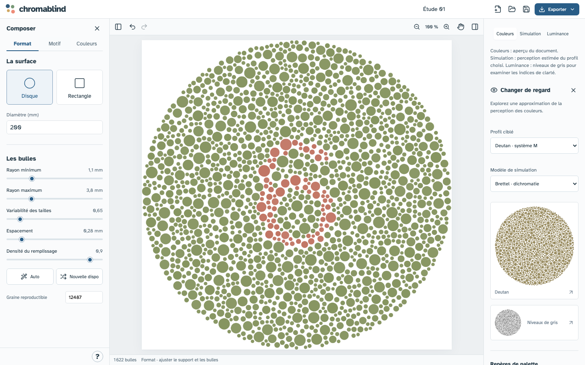
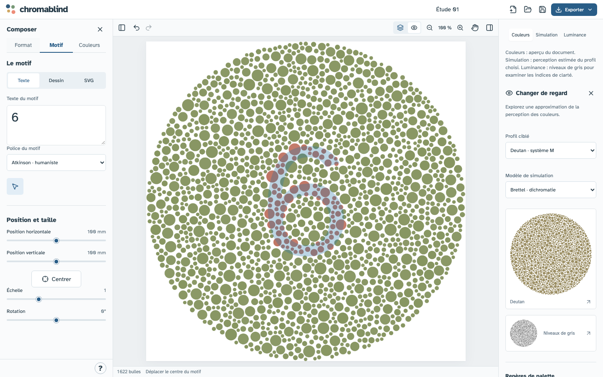
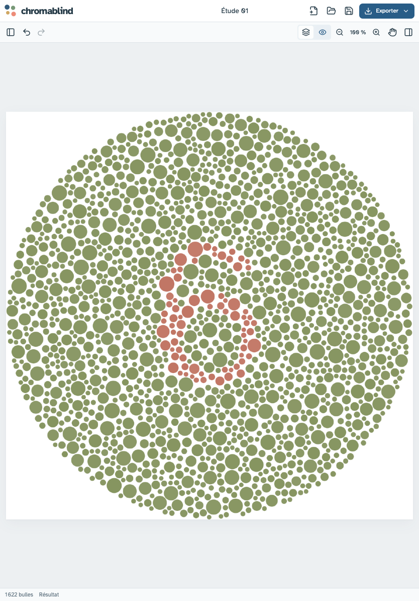
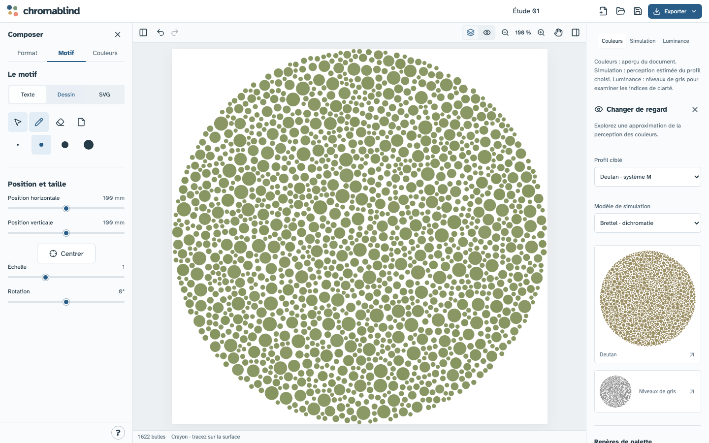

> [!WARNING]
> Ce projet a été vibecodé avec l’aide de l’intelligence artificielle.

# chromablind

[](https://github.com/charlescoiffier/chromablind/actions/workflows/ci.yml)

Un atelier web pour créer des illustrations à bulles colorées dans l’esprit des planches d’Ishihara,
et explorer ce que les modèles de perception changent dans leur lecture.

**[Essayer l’application](https://charlescoiffier.github.io/chromablind/)** · Version **0.3.0**

L’édition se fait sur votre appareil, sans compte. Les exports PDF et les épreuves avancées utilisent
un petit service de conversion qui traite les fichiers en mémoire. L’application est un outil de création
et de pédagogie ; elle ne constitue pas un test de dépistage.

## Aperçu



| Concevoir un motif | Voir le résultat sur tablette |
|---|---|
|  |  |



---

# Pour tout le monde

## Le projet en bref

Les planches pseudo-isochromatiques présentent un motif au milieu de disques de tailles et de couleurs variées.
Certaines différences de couleur deviennent difficiles à distinguer pour certains profils de vision. Le motif
peut alors s’effacer, ou un autre signal peut mieux se distinguer.

chromablind permet de composer ce type d’image, de comparer son aperçu avec des simulations et de préparer
un fichier pour l’impression. Il ne prédit pas ce que verra une personne précise. Les effets cachés et à deux
lectures restent des recettes expérimentales, à vérifier avec des observateurs et des épreuves physiques.

## Composer une illustration

Un **Nouveau** projet commence sans motif, avec les paramètres recommandés pour un disque de 200 mm, la palette **Guidée** et l’effet **Lecture standard**. Ces réglages s’appliquent aussi à la première ouverture ; les projets enregistrés gardent leurs propres choix.

1. **Format** : choisir un disque ou un rectangle, saisir les dimensions en millimètres, puis valider avec
   **Entrée** ou en quittant le champ. La frappe seule ne relance pas le remplissage.
2. **Les bulles** : régler les rayons, leur variabilité, l’espacement et la densité. **Auto**
   adapte les proportions au support, à partir de la référence 200 mm : rayons 1,1–3,8 mm, distribution 0,65,
   espacement 0,28 mm, densité visée 0,9. La compacité obtenue dépend du remplissage ; ce n’est pas une garantie
   de couverture à 90 %. Une graine conserve la même disposition. Limite : **20 000 bulles**.
3. **Motif** : saisir un texte accentué, choisir une des quatre polices, importer un SVG vectorisé ou dessiner.
   Le crayon et la gomme disposent de quatre épaisseurs ; **Tout effacer** vide le dessin. Les brouillons texte et dessin sont conservés lors du changement d’onglet.
4. **Conception / Résultat** : la surface bleue translucide aide à placer le motif ; le résultat affiche uniquement
   les bulles. Le bouton **Centrer** replace le motif au centre du support. Les coordonnées horizontale et verticale désignent le centre du motif. Le déplacement, la rotation
   et l’échelle sont indépendants du remplissage. **Annuler / Rétablir** restent disponibles.
5. **Couleurs** : choisir une création libre ou une recette guidée. L’onglet affiche toujours le résultat.
   En création libre, choisir la **Base** ; les couleurs de **Motif A** et **Motif B** sont calculées selon l’effet et le profil ciblé. Les réglages cyan, magenta,
   jaune et noir sont accessibles dans le sélecteur CMJN de la base ; les autres familles calculées sont affichées sans édition.

Les deux panneaux latéraux se masquent avec les boutons de la barre haute. Ils défilent seuls : le dessin reste
centré et prend la place disponible. L’outil main permet de déplacer la vue après un zoom. Le zoom agrandit l’image autour de son centre, sans ajouter de défilement. À deux doigts, le pincement zoome et le déplacement panote ; un doigt déplace la vue en Résultat ou dans Format.
La fine bande basse indique le nombre de bulles, l’outil et les notifications. Le bouton rond **?**, au pied du
panneau gauche, ouvre **Comprendre les modèles**, **Méthode et limites** et **Infos**, avec la version de l’application.

## Choisir un effet

| Effet | Intention |
|---|---|
| **Lecture commune** | Une différence modérée de clarté, tout en conservant une teinte. Recherche une lecture robuste par la clarté. |
| **Lecture standard** | Le motif tend à se confondre avec la base pour le profil ciblé, en mode guidé. |
| **Lecture daltonienne** | Un signal conservé peut mieux se distinguer quand le bruit chromatique est réduit par le modèle. Expérimental. |
| **Deux lectures** | A vise une lecture plus difficile pour le profil daltonien ciblé ; B, pour la vision standard. Composer A et B dans l’onglet Motif. Expérimental. |

En création libre, les couleurs sont calculées autour de votre base suivant l’axe de confusion du profil ciblé.
La marge disponible dans le gamut limite la séparation : une base extrême peut ne pas permettre l’effet recherché.
**Lecture commune** recherche une séparation de clarté dans les deux modes. Les recettes guidées réservent la marge de couleur nécessaire à leurs signaux au lieu de rejeter
les réglages initiaux comme hors gamut. Une conversion d’impression peut encore atténuer leur effet.

## Comparer les regards

- **Couleurs** : l’aperçu écran des couleurs CMJN du document.
- **Simulation** : une approximation selon le profil protan, deutan ou tritan choisi à droite. L’application ne
  détecte pas votre propre vision et ne corrige pas automatiquement l’image pour vous.
- **Luminance** : les niveaux de gris, pour repérer les différences de clarté qui pourraient révéler un motif.

Brettel simule les dichromaties protan, deutan et tritan. Machado propose un degré variable pour protan et deutan.
Son curseur est un paramètre mathématique, pas une mesure clinique. Les indicateurs de luminance et d’écart
colorimétrique sont des aides à la conception, sans score garantissant la lecture humaine.

## Sauvegarder et exporter

La sauvegarde automatique conserve le projet dans le navigateur. Elle dépend du stockage disponible et n’est
pas une sauvegarde distante. Pour conserver votre travail durablement, télécharger le projet.

| Format | Contenu |
|---|---|
| **Projet chromablind** | JSON réouvrable : dimensions, paramètres, graine, motifs, polices, traits, bulles finales et couleurs CMJN avec leur référence ICC. C’est exactement le même fichier que le bouton **Sauvegarder**. |
| **SVG** | Bulles vectorielles, dimensions physiques, aperçu sRGB portable. Les CMJN et leur profil de référence sont conservés dans les métadonnées. |
| **PDF CMJN** | Bulles vectorielles et composantes CMJN enregistrées, avec le profil ICC intégré et un OutputIntent. FOGRA39 par défaut. |

Le CMJN n’est pas une couleur universelle : un même pourcentage d’encre dépend du papier, des encres et du profil.
La référence retenue est **Coated Fogra39L VIGC 260**, pour papier couché et limite d’encrage 260 %. Le navigateur
calcule un aperçu sRGB par tables interpolées ; l’export PDF conserve les nombres CMJN exacts si le profil ne change pas.
Les **options avancées d’impression** permettent de sélectionner FOGRA47 ou d’importer le profil CMJN de l’imprimeur :
les couleurs sont alors reconverties par LittleCMS. Vérifier une épreuve physique pour une création exigeante.

Le SVG n’offre pas de rendu CMJN portable dans les navigateurs : **utiliser le PDF pour livrer du CMJN**.
La conformité **PDF/X n’est pas revendiquée** ; elle nécessite un validateur de prépresse indépendant.

---

# Pour les développeuses et développeurs

## Démarrer en local

Prérequis : **Node.js 24 LTS** (ou 22 LTS), **Python 3.14**, LittleCMS 2. Sous Linux, installer `liblcms2-2`.
Pillow fournit un moteur de secours sur macOS.

```sh
npm ci --legacy-peer-deps
npm run dev
```

Dans un deuxième terminal :

```sh
python3 -m venv .venv
.venv/bin/pip install -r server/requirements-dev.txt
.venv/bin/uvicorn server.app:app --host 127.0.0.1 --port 8000
```

Ouvrir **http://127.0.0.1:5173**. Vite transmet `/api` au service Python. L’édition, les tables CMJN locales, le projet
et le SVG fonctionnent sans l’API ; le PDF et l’épreuve avancée nécessitent le service.

## Architecture

- `src/core` : document JSON v1 enrichi de données CMJN, packing reproductible, masques vectoriels, recettes,
  simulations, tables colorimétriques et export SVG.
- `src/components/Plate.tsx` : Canvas 2D et Pointer Events pour la souris, le tactile et le stylet. Le motif de
  travail est un masque translucide ; la gomme soustrait les traits précédents sans modifier leurs vecteurs.
- `src/App.tsx` : édition, historique, panneaux, worker interruptible, stockage local et exports.
- `server` : FastAPI, limites de requête, validation ICC, conversions LittleCMS en double précision et PDF pydyf.

La géométrie est calculée dans un **Web Worker**, avec un index spatial pour éviter les chevauchements. Les palettes
et les motifs recolorent les bulles existantes. Les imports SVG conservent les règles de remplissage et l’union des
formes ; les scripts et contenus actifs sont supprimés. Les textes et contours doivent être vectorisés avant import ;
les masques et découpes non convertis sont refusés.

Les traits stockent chacun leur épaisseur et leur opération crayon/gomme. Leur masque raster sert seulement à mesurer
le centre des parties restantes, avec une résolution bornée ; les tracés sauvegardés restent vectoriels. Le remplissage
utilise toujours la position du **centre de chaque bulle** dans la région du motif.

## Couleurs et provenance

Les CMJN maître sont normalisés entre 0 et 1 et associés au SHA-256 du profil FOGRA39 fourni. XYZ D65 est une référence
perceptive dérivée, obtenue depuis le Lab PCS du profil puis adaptée de D50 à D65 par Bradford. Les couleurs hors gamut
écran restent conservées dans le document ; seul leur affichage est écrêté en sRGB. Les conversions LMS de Brettel
utilisent Smith–Pokorny et deux plans ; les matrices Machado sont interpolées entre les niveaux publiés.

Les tables locales `public/color` sont générées avec le même profil et LittleCMS : grille RGB 33³, grilles CMJN 17⁴
pour RGB et XYZ. Interpolation multilinéaire en nombres flottants. Elles sont des approximations de conception/aperçu,
**pas la chaîne d’export**. Le serveur émet les encres maître directement ou réalise une conversion ICC native lorsque
le profil de sortie change. Pour reconstruire les tables :

```sh
.venv/bin/python -m scripts.build_color_tables
```

Les anciens projets XYZ sont lus et convertis en CMJN à l’ouverture. L’ancien stockage local `chromatique.project.v1`
est reconnu ; les nouvelles sauvegardes utilisent `chromablind.project.v1`. Les données finales CMJN et les coups de
pinceau sont validés à la réouverture. Les polices embarquées sont Atkinson Hyperlegible, Noto Sans, Noto Serif et Roboto
Mono, en graisse normale, avec leurs licences libres.

Références et limites : [théorie et recettes](docs/science.md), [qualification](docs/qualification.md),
[notices de licences](public/THIRD_PARTY_NOTICES.txt), [ICC : profils et CMJN](https://www.color.org/faqs/).

## Tests et intégration continue

```sh
npm run check
.venv/bin/python -m pytest server -q
npx playwright install chromium firefox webkit
npm run test:ui
```

Démarrer le service Python sur le port 8000 avant les scénarios PDF. Les tests couvrent reproductibilité, collisions,
conversions de référence, recettes, données CMJN, conservation des encres PDF, SVG, réouverture, gomme, historique,
aide, dimensions au clavier et rendu de 20 000 bulles. WebKit au format iPad ne remplace pas un essai sur appareil physique.

Le workflow [CI](https://github.com/charlescoiffier/chromablind/actions/workflows/ci.yml) effectue les tests du moteur,
la compilation, les tests Python et les parcours Chromium/Firefox/WebKit à chaque push et pull request. Le build est
conservé sept jours comme artefact ; les diagnostics de navigateur sont conservés en cas d’échec. Le badge reflétera
les exécutions GitHub. Sur un push vers `main`, le workflow publie ensuite l’éditeur sur GitHub Pages.

## Déployer

L’éditeur est hébergé sur **[GitHub Pages](https://charlescoiffier.github.io/chromablind/)**.
Les projets et SVG se sauvegardent depuis le navigateur. GitHub Pages ne peut pas exécuter le service Python :
le PDF CMJN et l’épreuvage sont désactivés sur cette version. Pour ces fonctions, utiliser le déploiement complet ci-dessous.

Le workflow publie les fichiers statiques après les vérifications sur `main`, avec le préfixe `/chromablind/`.
Une API distante peut être indiquée au build avec `VITE_EXPORT_API_URL` (URL HTTPS complète se terminant par `/api`) ;
elle doit autoriser cette origine dans sa configuration CORS.


```sh
docker compose up --build
```

L’application est servie sur **http://127.0.0.1:8080**. Configurer HTTPS et le nom de domaine avec un reverse proxy
pour un accès public. Les fichiers Docker sont fournis ; leur démarrage reste à vérifier sur un hôte avec Docker actif.

L’API est non privilégiée, avec système de fichiers en lecture seule, limites de mémoire et de concurrence. Nginx borne
la taille et la fréquence des exports. Les documents et profils importés acceptés sont traités en mémoire, puis fermés.
Aucun projet n’est conservé côté serveur. Les journaux d’accès n’enregistrent pas les corps de requête.

Pour ajouter un profil de sortie, déposer un `.icc` et un `.json` de même nom dans `server/profiles`, avec `name`,
`description` et `source`, et vérifier son droit de redistribution. Le répertoire est configurable via `CHROMATIQUE_PROFILES`
(nom historique conservé). La référence CMJN maître reste FOGRA39 ; un profil supplémentaire est une destination d’export.

## Qualification à poursuivre

Les essais perceptifs avec observateurs, les épreuves imprimées, Safari sur iPad physique et la validation PDF/X sont
séparés des tests logiciels. Aucune promesse de visibilité pour un pourcentage de population n’est publiée sans étude.
